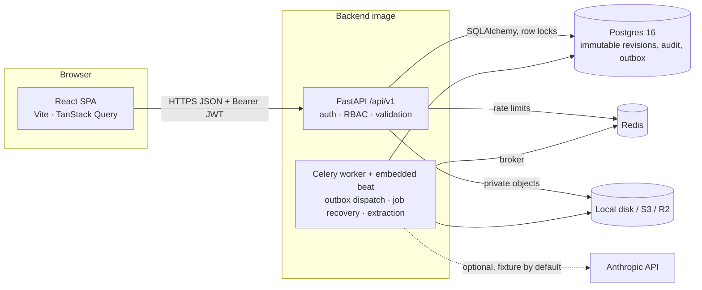

# Architecture

FactoryBridge is a **modular monolith**: one FastAPI service and one Celery worker built from the same image,
sharing Postgres (system of record) and Redis (broker, rate limits). The React SPA talks only to `/api/v1`.
Rationale: [ADR 0001](docs/adr/0001-modular-monolith.md).

## Module boundaries (`backend/app`)

| Layer | Modules | Rule |
|---|---|---|
| `domain/` | `bom`, `baseline`, `graph`, `impact`, `rules`, `artifacts`, `readiness` | Pure functions, no I/O. All gating decisions are computed here and unit/property tested. |
| `services/` | `changes_service`, `approvals_service`, `exceptions_service`, `artifacts_service`, `plan_service`, `state`, `audit`, `idempotency`, `outbox`, `storage`, `extraction/*` | Transactions, locking, persistence, audit. Call domain functions; never trust request bodies for roles/status. |
| `api/v1/` | `auth`, `projects`, `documents`, `misc` | HTTP mapping, RFC 7807 errors, envelopes, idempotency headers. |
| `workers/` | `celery_app`, `tasks` | Thin wrappers that call service functions; safe under at-least-once delivery. |
| `integrations/` | `anthropic_provider` | Optional live extraction via httpx; output is untrusted data. |
| `models/` | SQLAlchemy entities + enums; Alembic migrations `0001`, `0002` | DB triggers make `bom_items`, `audit_events` and revision identity columns append-only. |

## Core flows

**Baseline.** A BOM revision is immutable; its baseline hash is SHA-256 over the canonical, line-key-sorted BOM.
`projects.baseline_version` increments on every published revision and is the optimistic-concurrency token
clients send as `expected_baseline_version`.

**Publish a change** (`changes_service.publish_change`, one transaction, project row `FOR UPDATE`):
diff → impact traversal (`domain/impact.py`, BFS over `source → dependent` edges) → new immutable revision →
stale-mark affected artifacts → open deduplicated exceptions (`dedup_key`) → stale every approval of the old
baseline → recompute readiness → audit events → outbox event. Either all of it commits or none of it does.

**Approval** ([ADR 0002](docs/adr/0002-revision-bound-approvals.md)): a request is bound to the baseline hash and
version at request time and assigned to an eligible approver (never the requester or an author of unreleased
changes). The decision locks the project row, re-checks the hash pin, role, assignment and freshness, then
recomputes readiness. A publish and a decision serialize on the same lock, so READY can never refer to a stale
baseline (tested with 6 interleavings in `test_reliability.py`).

**Readiness** (`domain/readiness.py`) is derived, never set by a client. Blockers: `NO_BOM_REVISION`,
`EXTRACTION_PENDING`, `NO_DEPENDENCY_GRAPH`, `ARTIFACT_MISSING`, `ARTIFACT_NOT_VALID`, `OPEN_EXCEPTION`
(HIGH/CRITICAL), `APPROVAL_REQUIRED`.

**Artifacts** (supplier selection, compatibility check, work instruction, QC plan) are versioned. Every new revision
is validated server-side against the current baseline: suppliers must be approved for the exact part/revision with
enough quantity; compatibility rules are evaluated (an `UNKNOWN` result is invalid, never a pass); WI/QC must pin
current part numbers, revisions and attributes; QC checks on a pinned attribute must expect its current value
(`QC_CHECK_STALE`); QC plans pin the revision of the work instruction they verify. An exception resolves only with a
new, VALID revision created after the invalidation.

**Document extraction.** Upload → checksum-deduplicated private object + `processing_jobs` row + outbox event
(same transaction). The worker claims the job with a lease token, parses (CSV deterministically; PDF via pypdf),
calls the provider (fixture parser or Anthropic), and **re-verifies every cited excerpt against the page text**.
Output is stored as candidates only. An engineer must accept/edit (with a note)/reject each candidate; only then is
R1 created or a PROPOSED change opened. Model output never touches BOM, readiness or approvals directly.

## Reliability mechanisms

| Concern | Mechanism |
|---|---|
| Lost or duplicated events | Transactional outbox; dispatcher uses `FOR UPDATE SKIP LOCKED`; handlers are idempotent |
| Worker death mid-job | Lease token + `started_at`; recovery beat re-queues stale jobs; a zombie worker's commit is rejected when its lease was taken over |
| Retried client writes | `Idempotency-Key` with request fingerprint, Postgres advisory lock per key, stored response replay (`Idempotent-Replayed: true`) |
| Duplicate exceptions / runs | Unique `dedup_key` columns, upsert-or-reopen semantics |
| Concurrent publish / decide | Project row lock + `expected_baseline_version` / `expected_baseline_hash` checks → 409 |
| Audit ordering | `audit_events.seq` BIGINT identity (migration `0002`) gives a total order independent of clock ties |

## Security model (summary — see [threat model](docs/threat-model.md))

JWT (HS256, 30 min) with the user's role and active flag **re-read from the database on every request**; Argon2
password hashes; every query org-scoped (cross-org access returns 404); role matrix enforced in services; upload
sniffing (extension + magic bytes, active PDF content rejected, 10 MB cap); Redis rate limits per IP and per
account; strict CORS allowlist; security headers on API and SPA; production refuses to start with insecure secrets,
wildcard/non-HTTPS CORS, local DB URLs or local storage.

## Frontend (`frontend/src`)

React 19 + TypeScript, React Router, TanStack Query (project-scoped keys `["p", projectId, …]`), Tailwind v4,
`@xyflow/react` for the impact graph. API types are generated from the backend OpenAPI schema
(`npm run gen:api`). The UI never computes readiness: banners, blockers and badges render server state. Every page
carries the "SYNTHETIC DATA / SIMULATION — NOT MANUFACTURING CERTIFICATION" banner and a non-affiliation footer.

## Measured performance (local, see `TEST_RESULTS.md`)

Impact assessment on a 2,000-node / 5,000-edge DAG: p95 5.16 ms (target < 2 s). API GET project / impact /
dependency-graph against the local Docker stack: p95 68 / 59 / 68 ms (target < 500 ms). Single machine, sequential
requests; not a load test.
