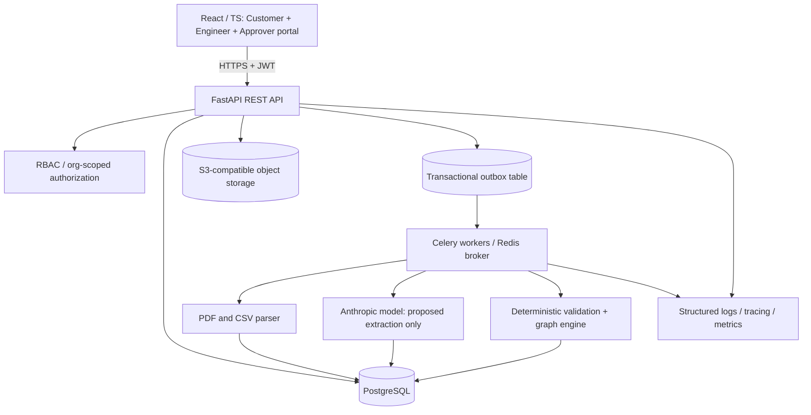

# FactoryBridge — AI-Powered Manufacturing Change Intelligence

**Version:** 1.0  
**Date:** 2026-11-09  
**Status:** Implementation-ready product and engineering specification  
**Audience:** Cursor (primary implementer), Codex (independent verifier), Claude Code (architecture and reliability reviewer)  
**Project category:** Independent demonstration project inspired by the publicly described manufacturing/AI workflows of Infi Robotics. **Not affiliated with Infi Robotics.**

---

## 0. Mission and constraints

Build a real, fully deployable web application that receives product requirements for a small, non-hazardous warehouse service robot, extracts structured component and assembly data, versions the bill of materials (BOM), models dependencies between engineering decisions, detects changes that invalidate downstream artifacts, and uses human approval to control manufacturing **readiness**. All production activity is **simulated**; the software must never actuate real hardware or claim that it certifies manufacturing safety.

### Why this matters to the target company

Publicly listed Founding AI Engineer responsibilities include customer intake/requirements, BOMs, sourcing, work instructions, scheduling, quality records, exceptions, evaluations, permissions, and human review. A separate publicly described software-engineering remit includes connecting requirements, design revisions, assembly instructions, quality checks, and operator workflows. This prototype shows an independent solution to a related **class of problems**, not knowledge of Infi's internal software or whether it has solved the problem already.

Public source: https://wellfound.com/jobs/4884727-founding-ai-engineer (reviewed November 9, 2026). 

### Success scenario (non-negotiable)

1. Sign in as a `customer` and create a *Warehouse Scout V1* project for a sample 100-unit production batch.
2. Upload a synthetic, text-based PDF requirements sheet and/or pre-generated CSV BOM. No company proprietary files or personal information.
3. The backend extracts requirements and tentative BOM rows; the UI displays evidence (document, page/section, snippet), missing fields, and uncertainties.
4. An `engineer` reviews and accepts corrected extraction, creating immutable BOM revision R1.
5. Associate R1 with approved synthetic supplier selection, work instruction revision, and inspection checklist.
6. An `approver` approves the project readiness baseline R1; the project displays `READY`.
7. Upload/enter engineering change EC-001: replace actuator `ACT-100` with `ACT-200` (different voltage, mounting pattern and/or torque requirement) in BOM revision R2.
8. Deterministic impact traversal identifies and explains at least four affected artifacts: supplier selection, electrical compatibility check, assembly instructions, QC test plan, and prior approval.
9. Project becomes `BLOCKED`; UI shows changed nodes, impacted nodes, evidence, reason codes, severity, and required owners. Previous approval is preserved for audit, but is no longer valid for R2.
10. A customer or AI cannot override the block. An authorized engineer fixes the artifacts; an authorized approver reviews the new baseline and approves. Only then can R2 become `READY`.
11. Show an append-only audit log, worker/event traces, and tests proving stale approvals and race conditions fail safely.

### Absolute boundaries

- Never claim integration with Infi, its robotics hardware, real suppliers, CAD tooling, or factory systems.
- Never infer real-world engineering safety or part compatibility from LLM text. **Use only explicit synthetic engineering constraints** and mark uncovered checks as `UNKNOWN/REVIEW_REQUIRED`.
- Do not auto-place purchase orders, change manufacturing equipment, or command robots.
- If no model/API key is present, the seeded fixture-based deterministic walkthrough must still run and be clearly labeled `fixture mode`.
- Do not fabricate benchmark numbers or claim the application is production-certified.
- Scope to **one coherent vertical slice** before adding breadth. Favor correctness over visual effects.

---

## 1. Product definition and user personas

**Name:** FactoryBridge  
**Tagline:** From changing hardware designs to explainable, approval-gated manufacturing readiness.  
**Differentiator:** *Engineering change blast-radius analysis* — not another document chatbot.

### Personas and permissions

| Role | Goals | Can | Cannot |
|---|---|---|---|
| Customer | Submit requirements and view progress | Create project, upload documents, propose changes, view customer-safe status | Edit internal sourcing/QC, approve release, access other organizations |
| Engineer | Validate BOM and resolve manufacturing issues | Review AI extraction, create BOM revisions, manage dependencies, resolve exceptions, draft instructions/checks | Self-approve if change author; bypass hard gates |
| Approver | Release engineering baseline for simulated production | Approve/reject a fully validated **specific** baseline; view audit | Approve stale revisions, unresolved critical findings, own changes |
| Admin | Manage project users and policies | Invite/disable users, assign roles, inspect audit | Bypass safety-critical release gate without distinct approver; delete audit history |
| Readonly observer (optional P1) | Inspect demo | Read non-sensitive project status | Mutate anything |

**P0 authorization:** one seeded demo organization, at least one user per role, role scoping enforced by backend. **P1:** genuine multiple-organization membership and invitations. All records include organization ownership to avoid a migration later.

### Core business objects

Organization → Project → Document(s) → Extracted requirement candidates → BOM revision(s) → Engineering changes → Dependency edges → Impact assessments → Issues/exceptions → Approvals → Readiness state → Simulated production job → Audit log.

---

## 2. Scope by priority

### P0 — Required to contact the founder with a credible demonstration

- Account sign-in with role-based access; seeded non-production demo accounts.
- Create/list/view a project and upload one text-readable PDF plus CSV BOM; max 10 MB per document.
- Document parser with anchored provenance (document, page, excerpt); unsupported/scanned input returns a comprehensible error, not hallucinated extraction.
- AI extraction into typed **candidates** with confidence/uncertainty and quoted evidence; engineer review before committing to a BOM.
- Immutable BOM R1/R2 revisions, materialized diff, no silent overwrite of prior baseline.
- Synthetic supplier catalog and **explicit machine-readable compatibility rules** (not LLM judgments).
- Dependency graph of BOM items → supplier decisions → electrical/mounting/assembly checks → quality plan → readiness approval.
- Deterministic change-impact traversal, explanation codes, generated exceptions, version-bound invalidation.
- Approver-specific authorization and freshness checks; no ready status with unresolved critical issues.
- Engineer UI: project overview, BOM diff, impact graph, exception inbox, approvals, audit timeline.
- Background processing jobs with durable results, retries, and visible state.
- Working Docker Compose, database migrations, seed script, automated tests, CI, production demo URL.
- 90-second reproducible demo with fixture mode; AI live mode is separately testable.

### P1 — Useful after P0 is sound

- Supplier alternatives with lead-time/cost as **synthetic** catalog entries.
- Simulated production run and QC defect workflow.
- Customer-facing limited status page.
- Versioned work instructions and inspector acknowledgments.
- Agent evaluation dashboard, cost/latency tracing, job metrics, alerts.
- An API-based simulated robotic-cell adapter that generates status events but has **no real actuator access**.

### P2 — Excluded from next-week delivery

Real robot control, ROS deployment, actual CAD parsing/manufacturability, PLM/ERP integrations, real purchase orders, financial payments, actual supplier API integration, physical certification, demand forecasting, full MRP/ERP or multi-site scheduling, autonomous AI write access, generic agent swarms.

---

## 3. Reference architecture and component ownership



### Technology choices — pin versions in lockfiles, not in this document

- **Frontend:** React, TypeScript, Vite, Tailwind, shadcn/ui, TanStack Query, React Flow, React Router; Vitest and Playwright.
- **Backend:** Python 3.12+, FastAPI, Pydantic v2, SQLAlchemy 2, Alembic, PyJWT or equivalent maintained JWT tooling, Argon2 password hashing, pytest.
- **Database:** PostgreSQL 16+ locally; integer/UUID primary keys and constrained enum-like strings; JSONB for candidate extraction and rule details, relational tables for core state.
- **Workers:** Celery with Redis broker, durable job status stored in PostgreSQL. Limit concurrency and retries.
- **Storage:** Local MinIO for development if convenient, S3-compatible bucket in deployment; checksum each upload; never trust user-supplied path.
- **AI provider:** Anthropic API behind an adapter. Strict Pydantic schema validation and explicit timeout/cost caps. No tool execution rights for LLM.
- **Observability:** structured JSON logs with correlation IDs, OpenTelemetry instrumentation, minimal Prometheus-friendly metrics.
- **Deployment:** Vercel static frontend, Render or comparable service for API + worker, managed PostgreSQL + managed Redis, S3/R2 object storage. All must be private/secrets-aware. See Section 16.

Architecture decision: **modular monolith + separate background worker**, not microservice sprawl. The domain package must be independent from web routes and AI provider. The rules engine must be callable as pure Python functions with unit tests.

### Request paths

1. Upload request: API authenticates → validates MIME/size → streams to private object storage → commits Document row + outbox `DocumentUploaded` within one DB transaction → worker parses/extracts → status `REVIEW_REQUIRED`.
2. Engineering change: API validates ownership/base revision → commits new immutable BOM revision and change set → graph analyzer computes affected artifacts, sets issues + readiness block, writes audit/outbox → UI refreshes.
3. Approval: API starts DB transaction → row locks project/readiness + baseline → checks assigned role, separation of duties, zero unresolved critical issues, matching baseline hash and version → inserts approval + audit and atomically changes state.

---

## 4. Domain and database requirements

Use UUID primary keys and UTC `created_at/updated_at`. Every resource carries `organization_id` and `project_id` where relevant. Avoid hard deleting approved business records.

### Tables — P0

| Table | Required fields / constraints |
|---|---|
| `organizations` | `id`, `name`, `slug` unique |
| `users` | `id`, `organization_id`, `email` scoped unique, `password_hash`, `role`, `is_active` |
| `projects` | `id`, `organization_id`, `name`, `sku`, `target_quantity`, `status`, `current_bom_revision_id`, `baseline_version` int, `row_version` int |
| `documents` | `id`, `project_id`, `organization_id`, `filename`, `media_type`, `sha256`, `storage_key`, `processing_status`, `page_count`, `uploaded_by` |
| `extraction_runs` | `id`, `document_id`, `model`, `prompt_version`, `status`, `input_tokens`, `output_tokens`, `latency_ms`, `cost_usd_estimate`, `raw_output_ref`, `error_code` |
| `requirement_candidates` | `id`, `extraction_run_id`, `field_path`, `value_json`, `unit`, `source_page`, `source_excerpt`, `confidence_label`, `review_state`, `reviewed_by` |
| `bom_revisions` | `id`, `project_id`, `revision_number`, `parent_revision_id`, `content_hash`, `status`, `created_by`, `created_at` with unique `(project_id, revision_number)` |
| `bom_items` | `id`, `bom_revision_id`, `line_key`, `part_number`, `description`, `quantity`, `unit`, `part_revision`, `attributes_json`; unique `(bom_revision_id, line_key)` |
| `supplier_options` | `id`, `organization_id`, `part_number`, `vendor_name`, `available_qty`, `lead_days`, `approved_for_part`, `synthetic=true` |
| `artifacts` | `id`, `project_id`, `artifact_type` (`SUPPLIER_SELECTION`, `COMPATIBILITY_CHECK`, `WORK_INSTRUCTION`, `QC_PLAN`), `revision`, `status`, `content_json`, `based_on_hash`, `created_by` |
| `dependency_edges` | `id`, `project_id`, `source_node_key`, `target_node_key`, `dependency_type`, `rule_code`, `is_active`; unique scoped edge |
| `engineering_changes` | `id`, `project_id`, `from_bom_revision_id`, `to_bom_revision_id`, `submitted_by`, `reason`, `status`, `created_at` |
| `impact_assessments` | `id`, `change_id`, `baseline_hash`, `impact_graph_json`, `rule_version`, `summary_json`, `computed_at` |
| `exceptions` | `id`, `project_id`, `change_id`, `artifact_id` nullable, `reason_code`, `severity`, `status`, `description`, `required_action`, `resolved_by`, `resolved_at`, `resolution_note` |
| `approval_requests` | `id`, `project_id`, `baseline_hash`, `baseline_version`, `requested_by`, `assigned_approver_id`, `status`, `reviewed_at`, `reason` |
| `audit_events` | `id`, `organization_id`, `project_id`, `actor_id` nullable, `action`, `resource_type`, `resource_id`, `before_json`, `after_json`, `correlation_id`, `created_at` — append only |
| `processing_jobs` | `id`, `kind`, `resource_id`, `attempt`, `status`, `error_code`, `started_at`, `finished_at`, `next_retry_at` |
| `outbox_events` | `id`, `event_type`, `aggregate_id`, `payload_json`, `created_at`, `published_at`, `attempts` |
| `idempotency_records` | `(organization_id, request_key)` unique, `request_hash`, `response_json`, `expires_at` |

**Design notes:**
- Distinguish `line_key` (stable logical BOM line identity) from `part_number` (can change). Without stable identity, diff will look like delete+add.
- Immutable BOM revision after publication. Store a canonical sorted BOM content hash (`sha256` normalized BOM values, attributes, quantities); lock or compare project `row_version` for concurrency.
- Snapshot baseline hash must include BOM content hash **and exact active downstream artifact revision IDs/content hashes plus rule version**; if any changes, approval becomes stale.
- `audit_events` append-only at application permissions level; admins cannot erase through API. P1 database triggers can add protection.
- `exceptions` resolution needs updated evidence or artifact revision, not just a button.
- Index `(project_id, created_at)`, `(project_id, status)`, `project_id` across tables, `outbox_events(published_at)`.
- Use Alembic migrations. No runtime `create_all()` outside explicit isolated tests.

### Domain statuses

Project readiness: `DRAFT`, `EXTRACTING`, `REVIEW_REQUIRED`, `BLOCKED`, `READY`, `IN_PRODUCTION_SIMULATED`, `COMPLETED_SIMULATED`.

Extraction: `PENDING`, `PROCESSING`, `REVIEW_REQUIRED`, `FAILED`, `ACCEPTED`.

Exception: `OPEN`, `IN_REVIEW`, `RESOLVED`, `WAIVED` (waiver requires approver, rationale, and cannot waive hard-rule unsafe or unknown compatibility in P0).

Approval: `PENDING`, `APPROVED`, `REJECTED`, `STALE`.

**Invariant I-1:** `READY` requires a valid current approval for the current baseline hash and no unresolved critical exceptions.  
**Invariant I-2:** Changing any baseline input invalidates readiness and stale-marks prior approval **atomically**.  
**Invariant I-3:** No role except `approver` can grant release; for P0, approver must not be the submitting engineer.  
**Invariant I-4:** Every state-changing operation is organization-scoped, audit logged, and idempotent where externally retryable.  
**Invariant I-5:** Raw model output is never applied directly to production-domain state.

---

## 5. Functional requirements and acceptance criteria

### FR-01 Authentication and authorization (P0)

- Password login for seeded accounts; hashed credentials via Argon2. JWT expires and is verified with configured secret; protect all project routes.
- Every backend route checks membership + role + organization; never trust role in request body.
- For development, expose seeded logins in README. No default demo password publicly in production; deploy with rotated credentials or disabled seeded login.
- CSRF strategy required if cookie auth; bearer token storage strategy documented and implemented safely. No token logging.
- **AC:** customer receives 403 when attempting approval; cross-org project ID returns 404 or 403 without leaking fields; inactive user blocked.

### FR-02 Project/customer intake (P0)

- Create project: name, SKU, target_quantity >0, business description, optional target delivery date.
- Upload text-readable PDF or CSV; `.docx` optional P1. Validate file type from content, max 10 MB, and file checksum. Store private, not public URLs.
- System displays processing progress and errors. Not permit release while parsing or extraction unresolved.
- **AC:** a valid sample document appears with correct filename/page count; oversized or malformed file fails gracefully; a duplicate upload does not make duplicate active BOM automatically.

### FR-03 AI-assisted extraction with evidence (P0)

- Parser extracts page-separated text (prefer PyMuPDF/PDF parser; scans intentionally out of scope with clear message). CSV BOM is parsed deterministically, not through LLM.
- Prompt includes allowed schema: `project_name`, `target_quantity`, `product_sku`, `requirements[]`, `bom_candidates[]` with `part_number`, `description`, `quantity`, `unit`, `part_revision`, `attributes`, `source`.
- Required source evidence fields: `document_id`, `page_number` (for PDF), `exact_excerpt`, optional section. Server validates excerpt actually appears in parsed page text after normalization; else mark `UNVERIFIED`.
- Enforce `quantity >0`, normalized units, conservative ambiguity labels; unknown mandatory fields = `null` + issue, not guessed values.
- LLM returns **candidate data only**; human `engineer` reviews and accepts/corrects before creating BOM revision.
- Store model ID, prompt version, token counts/latency if provided, estimated cost assumptions separately.
- Resilience: provider timeout, 429, 5xx, malformed JSON, zero evidence; bounded retries with jitter and terminal error after max 3 attempts; no silent synthetic fallback.
- Injected instructions in uploaded documents must be treated as data; LLM has no tools or permissions to call APIs or change role.
- **AC:** contradictory quantities create review exception; sample test file produces structured candidates and provenance, a fabricated source citation cannot be accepted; mock/fake model testing can run offline.

### FR-04 BOM authoring, validation, and revisioning (P0)

- Engineer can edit candidates and publish R1. Later edits always create R2/R3; never alter published rows.
- Detect missing part numbers, duplicate stable keys, zero/negative quantities, unit incompatibility, and invalid attribute types.
- Render side-by-side change diff: ADDED, REMOVED, UPDATED, UNCHANGED by stable line key; show old/new part revision, quantity, attributes.
- **AC:** editing ACT-100 to ACT-200 results in one updated logical line and new BOM content hash; R1 remains viewable and cannot be modified.

### FR-05 Engineering dependencies + change impact (P0; signature feature)

- Model project dependency DAG with nodes `BOM_LINE`, `SUPPLIER_SELECTION`, `COMPATIBILITY_CHECK`, `WORK_INSTRUCTION`, `QC_PLAN`, `READINESS_APPROVAL`. Each directed edge records reason/rule code.
- Build/seed edges from **explicit rule mappings** for project, not inferred through LLM. Canonical traversal: changed BOM line → BFS/DFS downstream dependents; visited set; cycle detection at graph creation; deterministic ordering by node key.
- Mark impacted artifacts `REVALIDATION_REQUIRED` and open typed exceptions with reason and required action. Block readiness in same transaction as publishing changed baseline.
- Explain **why** each artifact was affected: source change, dependent field(s), edge path, rule code, last validated baseline hash.
- Track an impact assessment per change with affected node list, paths, impact score (optional; transparent weights only), and rule version.
- **AC:** synthetic actuator modification affects at least four downstream artifacts; repeated impact computation produces identical results; adding a cycle is rejected; unrelated branch remains unaffected.

### FR-06 Compatibility / sourcing checks (P0)

- Use explicit synthetic rule registry and part catalog: voltage ranges, connector types, mounting pattern IDs, torque requirements. Rule function returns `PASS`, `FAIL`, `UNKNOWN` with evidence and reason code.
- `UNKNOWN` critical compatibility must block readiness; AI suggestion alone cannot mark compatible.
- Supplier selection must link to exact part number/revision. A part change invalidates previous selected option until revalidated or replaced.
- **AC:** ACT-200 with new 48V requirement against 24V assembly rule is a deterministic `FAIL`, not a probabilistic LLM answer.

### FR-07 Exception inbox and resolution (P0)

- List exceptions sorted severity; filters by change, artifact, owner/status; each links to impacted node.
- To resolve a critical exception, engineer must attach a new artifact revision or rule-compliant evidence, and add reason. Re-run validations after resolution.
- Duplicate jobs must not create duplicate open exceptions; unique key `(change_id, artifact_id, reason_code)` where applicable.
- **AC:** toggling `resolved` without required new evidence fails; a previously resolved issue reopens on future invalidating change.

### FR-08 Approvals and readiness gate (P0)

- Engineer creates release request for exact current snapshot `baseline_hash`, `baseline_version`. Approver can approve/reject with a reason and identity.
- Approval preconditions: no critical exception, all relevant artifacts `VALID`, no unknown required compatibility, no pending extraction tasks, same baseline hash at commit.
- Use DB transaction + locks/optimistic version check; concurrent change vs approval cannot produce `READY` on stale data.
- On any changed dependency, old approvals `STALE`, project `BLOCKED` until new review; history preserved.
- No self-approval: request author != approver for P0.
- **AC:** request made on R1 cannot release R2; simultaneous approval and BOM edit leaves project in a valid state; customer cannot approve via API or crafted payload.

### FR-09 Audit and traceability (P0)

- Append immutable, organization-scoped audit entries for documents, extraction reviews, revision publication, dependency changes, issue resolution, approval decisions, readiness changes, and login-related security events (without sensitive data).
- Store actor identity, timestamp, correlation ID, old/new relevant fields. Redact tokens, secrets, raw document excerpts not required for audit.
- UI timeline filters by artifact and revision.
- **AC:** every approval references exact baseline and request; no mutation endpoint for audit; can reconstruct R1→R2 history.

### FR-10 Dashboard and explainability (P0)

- Screens: login; projects list; project details; document upload + extraction review; BOM + revision diff; change detail and dependency graph; exceptions; approvals; audit timeline.
- React Flow visually highlights changed nodes (blue), invalidated nodes (amber/red), valid nodes (neutral/green). Colors **plus labels/icons** for accessibility.
- Graph node click opens right-side detail with exact change, path, rule, remediation, and evidence.
- Show readiness status banner and **blocking reasons**; do not show `READY` because an API response was cached. Invalidate relevant query caches after writes.
- P0 customer portal can be a customer-safe project view reusing page components, with server permissions and no internal supplier details.
- **AC:** complete happy/negative demo can be performed through UI without direct API or DB edits.

### FR-11 Job reliability (P0)

- Document parsing/extraction executes in worker, not request thread.
- Worker job stored with status. Use unique deduplication key `document_id + extraction_version` and bounded retries; classify permanent vs retriable errors.
- Transactional outbox pattern: commit domain update and event record in same DB transaction. A dispatcher sends to broker; acknowledgments must be idempotent and not assume exactly-once delivery.
- Repeated messages/upserts should not duplicate BOM publications or exception rows.
- **AC:** worker killed after fetching an event can resume safely; identical event replay doesn't duplicate approval or exception; error becomes user-visible.

### FR-12 Simulated production operation (P1)

- Once `READY`, user with proper role may start a simulated batch. Jobs have state `QUEUED`, `RUNNING`, `QC_PENDING`, `COMPLETE`, `FAILED`.
- Simulated inspection receives a synthetic PASS/FAIL, creates traceable defects and blocks completion on failures; never send device commands.
- If BOM baseline changes during simulated production, pause and require revalidation; mark as `SIMULATION_ONLY` prominently.

---

## 6. Dependency graph and impact algorithm — technical contract

### Node identity and edge rules

`node_key = '<type>:<stable logical id>'`, e.g. `BOM_LINE:ACTUATOR_MAIN`, `SUPPLIER_SELECTION:ACTUATOR_MAIN`, `COMPATIBILITY_CHECK:MOTOR_VOLTAGE`, `WORK_INSTRUCTION:INSTALL_ACTUATOR`, `QC_PLAN:MOTOR_FUNCTION_TEST`, `READINESS_APPROVAL:PROJECT`.

Edges follow `source -> dependent`; reject cycles at edge insert. Do **not** treat an edge alone as a physical compatibility rule: it means "revalidation is necessary if upstream changes." Separate explicit deterministic validators determine whether new state is compatible.

### Required algorithm

```
function assess_impact(old_revision, new_revision, dependency_graph, artifacts):
    changes = stable_key_diff(old_revision.items, new_revision.items)
    seeds = node_keys_for_changes(changes)
    impacted = traverse_downstream_bfs(graph, seeds, sorted_neighbors=True)
    for each node in impacted:
        paths = shortest_explanatory_paths(seeds, node)
        previous = artifacts.current_for_node(node)
        mark_requires_revalidation(previous, new_revision.baseline_hash)
        issue = map_reason_code(paths, changes, node)
        upsert_exception(issue, unique_change_and_node_key)
    invalidate_approvals_for_previous_baseline()
    set_project_status(BLOCKED)
    append_audit_and_outbox_event()
    return impact_assessment(changes, impacted, explanation_paths, rule_version)
```

### Reason codes

- `BOM_PART_CHANGED`, `BOM_QUANTITY_CHANGED`, `PART_REVISION_CHANGED`, `SOURCING_REVALIDATION_REQUIRED`, `VOLTAGE_COMPATIBILITY_CHANGED`, `MOUNTING_INTERFACE_CHANGED`, `WORK_INSTRUCTION_STALE`, `QC_PLAN_STALE`, `READINESS_APPROVAL_STALE`, `MANDATORY_FIELD_MISSING`, `COMPATIBILITY_UNKNOWN`.

### Adversarial cases to test

- ACT-100 → ACT-200 causes same deterministic impact on rerun; no duplicate exceptions.
- 1 change, 2000-node DAG completes within bounded evaluation target; publish benchmark with hardware/test setup rather than promised production SLA.
- Cyclic dependency insertion rejected with 422 + actionable response.
- A BOM change does not invalidate unrelated battery packaging instructions if no dependency edge exists.
- Simultaneous R2 creation from R1 yields one winner and one HTTP 409 conflict, not R2 branches without explicit fork.
- Approval attempted after R2 publish fails even if UI shows R1 cached state.
- A newly accepted supplier decision does not silently validate a stale QC checklist.

---

## 7. AI extraction specification

### Provider contract

`ExtractionProvider.extract(document_text, page_map, schema_version, request_id) -> ExtractionResult`.

- Inputs: sanitized document text (with page boundaries), stable schema, role-independent system prompt, no tools/actions.
- Outputs: valid typed JSON with `requirements[]`, `bom_candidates[]`, `missing_fields[]`, `ambiguities[]`, `model_metadata`.
- Confidence must be categorical `HIGH/MEDIUM/LOW/UNKNOWN`, never represent a calibrated probability without evaluation.
- Evidence includes a literal excerpt and page; server verifies exact or normalized matching.
- Cost safeguards: max input bytes/tokens, 1 model call per extraction by default, 3 retries at most, configurable monthly/day budget cap for demo, flag cost estimate assumptions.
- Privacy: only synthetic uploads in public demo; log metadata, not whole documents.
- Prompt injection: treat document content as untrusted, use data delimiters, schema enforcement; never allow uploaded text to redefine tool permissions or decide approval.

### Example typed candidate

```json
{
  "line_key": "ACTUATOR_MAIN",
  "part_number": "ACT-100",
  "description": "Synthetic drive actuator",
  "quantity": 2,
  "unit": "each",
  "part_revision": "A",
  "attributes": {"voltage_v": 24, "mount_pattern": "M4-40"},
  "evidence": {"document_id": "<uuid>", "page_number": 2, "exact_excerpt": "ACT-100 rev A, 24V, qty 2"},
  "confidence": "HIGH",
  "review_state": "PENDING"
}
```

### Evaluation harness

- Store 30–50 synthetic labelled documents/scenarios at varying complexity, not copyrighted customer PDFs.
- Track exact match of part numbers, quantity accuracy, required field extraction, evidence-validity rate, unsupported-assertion rate, contradictions caught, and *false readiness approvals* (must be 0 for hard-gate tests).
- Model vs fixture mode must be labeled. All metrics computed from actual runs, fixed dataset and git commit.
- Hard rule validation always runs even if AI returns valid JSON.

---

## 8. REST API contract (`/api/v1`) — P0 endpoints

Use consistent JSON envelope for data and an RFC 7807-style error body. All IDs UUID; timestamps UTC. Write endpoints require appropriate role. Generate OpenAPI docs automatically. Pagination defaults 25, max 100.

| Method | Route | Required role | Purpose |
|---|---|---|---|
| POST | `/auth/login` | public | Log in and return token/session |
| GET | `/auth/me` | any authenticated | Current identity/organization/role |
| GET | `/projects` | any authenticated | List only authorized org projects |
| POST | `/projects` | customer/engineer/admin | Create project |
| GET | `/projects/{id}` | any authorized | Project + current readiness / blockers |
| POST | `/projects/{id}/documents` | customer/engineer | Multipart upload, returns 202 + job ID |
| GET | `/documents/{id}` | authorized project member | File metadata + job status + download permission |
| GET | `/documents/{id}/extraction` | engineer/admin | Candidates, evidence, issues |
| POST | `/documents/{id}/extraction/accept` | engineer | Reviewed corrections → creates R1 / later revision |
| GET | `/projects/{id}/bom/revisions` | authorized | List baselines |
| GET | `/projects/{id}/bom/revisions/{rev}` | authorized | Immutable BOM and hash |
| POST | `/projects/{id}/changes` | engineer/customer proposal | Create proposed engineering change; customer cannot publish directly |
| POST | `/projects/{id}/changes/{change_id}/publish` | engineer | Validate and publish new revision, compute impact |
| GET | `/projects/{id}/changes/{change_id}/impact` | engineer/approver/admin | Impact nodes, paths, reasons |
| GET | `/projects/{id}/dependency-graph` | engineer/approver/admin | Graph node/edge snapshot |
| GET | `/projects/{id}/exceptions` | engineer/approver/admin | Filtered blocker list |
| POST | `/projects/{id}/exceptions/{exception_id}/resolve` | engineer | Attach updated artifact/evidence then revalidate |
| POST | `/projects/{id}/approvals/request` | engineer | Request release for exact baseline |
| POST | `/projects/{id}/approvals/{approval_id}/decision` | assigned approver | Approve/reject with baseline freshness check |
| GET | `/projects/{id}/audit` | engineer/approver/admin | Paginated audit trail |
| GET | `/jobs/{id}` | authorized project member | Processing progress/error |
| GET | `/health/live` | public, minimal | Liveness without secrets |
| GET | `/health/ready` | internal/secured | DB/Redis dependency readiness |

### Required HTTP semantics

- `201` on created resource, `202` for queued work, `200` for retrieval/update.
- `400/422` invalid data; `401/403` auth; `404` missing/inaccessible; `409` stale revision or concurrent publish; `413` oversized file; `429` rate-limited.
- `Idempotency-Key` on POST change publish, extraction accept, approval decision (at least one-day record retention for demo). Same key+same body returns same outcome; same key+different body returns 409.
- Optimistic version via `If-Match`/`expected_baseline_version` on sensitive writes. Fail closed if stale.

### Example engineering change request

```json
{
  "base_revision_number": 1,
  "reason": "Customer revised drive actuator specifications",
  "changes": [
    {
      "line_key": "ACTUATOR_MAIN",
      "operation": "UPDATE",
      "new": {
        "part_number": "ACT-200",
        "description": "Synthetic 48V drive actuator",
        "quantity": 2,
        "unit": "each",
        "part_revision": "B",
        "attributes": {"voltage_v": 48, "mount_pattern": "M6-50"}
      }
    }
  ]
}
```

### Example impact response

```json
{
  "change_id": "<uuid>",
  "from_revision": "R1",
  "to_revision": "R2",
  "readiness": "BLOCKED",
  "changed_nodes": ["BOM_LINE:ACTUATOR_MAIN"],
  "impacted": [
    {"node": "SUPPLIER_SELECTION:ACTUATOR_MAIN", "severity": "HIGH", "reason_code": "SOURCING_REVALIDATION_REQUIRED", "path": ["BOM_LINE:ACTUATOR_MAIN", "SUPPLIER_SELECTION:ACTUATOR_MAIN"]},
    {"node": "COMPATIBILITY_CHECK:MOTOR_VOLTAGE", "severity": "CRITICAL", "reason_code": "VOLTAGE_COMPATIBILITY_CHANGED", "path": ["BOM_LINE:ACTUATOR_MAIN", "COMPATIBILITY_CHECK:MOTOR_VOLTAGE"]},
    {"node": "WORK_INSTRUCTION:INSTALL_ACTUATOR", "severity": "HIGH", "reason_code": "WORK_INSTRUCTION_STALE", "path": ["BOM_LINE:ACTUATOR_MAIN", "WORK_INSTRUCTION:INSTALL_ACTUATOR"]},
    {"node": "QC_PLAN:MOTOR_FUNCTION_TEST", "severity": "HIGH", "reason_code": "QC_PLAN_STALE", "path": ["BOM_LINE:ACTUATOR_MAIN", "QC_PLAN:MOTOR_FUNCTION_TEST"]},
    {"node": "READINESS_APPROVAL:PROJECT", "severity": "CRITICAL", "reason_code": "READINESS_APPROVAL_STALE", "path": ["BOM_LINE:ACTUATOR_MAIN", "READINESS_APPROVAL:PROJECT"]}
  ],
  "requires_approval": true
}
```

---

## 9. Frontend UX: required screens and behavior

### IA/navigation

Top-level: `Projects`, `Inbox`, `Audit` (if role permits), user/role display. Per project tabs: `Overview`, `Documents`, `BOM`, `Changes`, `Impact`, `Exceptions`, `Approvals`, `Activity`.

### Screens

1. **Projects list:** name, SKU, last edited, readiness, blocker count; create project action.
2. **Project overview:** KPI cards (BOM revision, unresolved critical blockers, approval freshness, document processing); clear status and next responsible action.
3. **Upload and evidence review:** drag/drop PDF/CSV, job state, extraction table with source snippets and accept/edit/reject.
4. **BOM revision history:** immutable revisions with diffs; selected row opens attribute comparison.
5. **Engineering change editor:** choose baseline, select line, edit part number/revision/attributes, supply reason; preview required before publishing.
6. **Impact graph:** React Flow nodes/edges; click node to inspect reason code, change path, last validation, required remediation.
7. **Exception inbox:** severity/status filters, responsible owner, resolution form with evidence attachment or linked artifact revision.
8. **Approval review:** show exact baseline hash suffix, BOM revision, checklist, outstanding issues; review and reject/approve buttons, stale conflicts visible.
9. **Audit timeline:** actor, action, before/after summary, timestamp, links to exact revisions.
10. **Customer status:** limited view with milestone/status and requests for missing info; no internal procurement details.

### UI requirements

- Desktop-first, usable at 1280px, mobile gracefully collapses tables; keyboard accessible.
- Loading, empty, failed, unauthorized, and stale-conflict states for every major screen.
- Color never sole indicator of risk; badges + text + icons.
- React Query invalidation after successful mutation; no frontend-only gating. Backend is source of truth.
- No hardcoded business outcomes in UI. All demo data served by API.

---

## 10. Synthetic dataset and reproducible demo

### Seed a single project

Product: `Warehouse Scout V1`, SKU `WS-100`, target quantity 100, organization `Demo Hardware Labs`.

Synthetic BOM example:

| line_key | part | qty/unit | critical constraints |
|---|---|---|---|
| ACTUATOR_MAIN | ACT-100 rev A | 2 each | 24V; mount `M4-40` |
| CONTROLLER | CTRL-24 rev A | 1 each | output 24V; connector `JST-X` |
| BATTERY | BAT-24 rev A | 1 each | 24V supply |
| CHASSIS | CHS-01 rev A | 1 each | accepts mount `M4-40` |
| SENSOR | SNS-02 rev A | 2 each | 24V interface |

Seed supplier options and three downstream artifacts keyed to the actuator: `SUP-100`, `WI-ACT-01`, `QC-ACT-01`, compatibility checks. Fixture R1 is valid after engineering/approver review.

Change EC-001: `ACT-100` → `ACT-200` (48V, `M6-50`) while controller, chassis, and work instruction remain 24V/old mount. Outcome: source change plus at least 4 dependency impacts, deterministic compatibility failure, `BLOCKED`, stale prior approval. Engineers can select an explicitly configured 24V compatible alternative `ACT-110` or revise multiple other components and checks to satisfy rules; no magical AI correction.

### Fixture assets

- `demo/requirements_v1.pdf` text-readable, generated from fully synthetic content.
- `demo/requirements_v2.pdf` updated actuator requirement.
- `demo/bom_v1.csv`, `demo/bom_v2.csv`.
- `demo/supplier_catalog.csv`, `demo/compatibility_rules.json`, `demo/expected_impact.json`.
- `demo/demo_script.md`, `demo/golden_test_results.json` (actual test results only; do not pre-fill invented values).

### Demo roles

`customer@demo.example`, `engineer@demo.example`, `approver@demo.example`; passwords generated locally and supplied via dev-only seed stdout or `.env`, never committed as production secrets. Disable or rotate demo accounts in deployed instance.

### 90-second video outline

0–15s: problem statement and uploaded requirements.  
15–30s: AI candidate extraction and source evidence.  
30–42s: reviewed R1 is `READY`.  
42–55s: ACT-200 design revision.  
55–72s: impact graph lights up supplier, compatibility, instruction, QC, approval.  
72–83s: stale approval blocked; engineer resolves alternate or corrected plan.  
83–90s: new approval, audit trail, and key verified tests.

---

## 11. Security and privacy requirements

- HTTPS-only in deployment; strict CORS allowlist; strong JWT secret; token expiry; password hashing Argon2.
- Backend authorization at every mutation and fetch; organization/project scope checked in SQL joins, not frontend only. Test IDOR access.
- File validation: max 10 MB; accepted extension+MIME+magic type; private storage; no raw user filename as storage key; reject path traversal and suspicious macro content; sandbox parser and set memory/time limits when feasible.
- Never send project files to LLM unless user explicitly initiates extraction; demo uses synthetic material only.
- Uploaded PDFs are untrusted prompt data; no instructions from document become privileged model/system instructions.
- Secrets only in environment/secret manager, `.env.example` contains placeholders. Redact auth headers, passwords, file content, and API keys from logs.
- Rate-limit sign in/uploads/extractions; enforce maximum AI usage per user/day and total token budget.
- Configure DB least privilege; backups, migrations, error reporting; object storage private with short-lived signed download URLs.
- Preserve audit history with immutable revision references. Public demo must display `SYNTHETIC DATA / SIMULATION — NOT MANUFACTURING CERTIFICATION`.
- Scan Python/JS dependencies in CI; no vulnerable dependencies accepted without documented exception.

---

## 12. Non-functional requirements and quality gates

Values below are **targets to measure**, not numbers to claim before tests run.

| Area | Target / verification method |
|---|---|
| Correctness | 100% deterministic hard-gate tests pass; zero stale release approvals in concurrent test suite |
| API speed | p95 GET project and GET impact graph < 500 ms on seed dataset under defined local load; document actual environment |
| Change impact | 2000-node / 5000-edge acyclic graph impact calculation p95 < 2 seconds in local benchmark; measure and optimize only if useful |
| Reliability | No duplicated exceptions after at-least-once event replay; worker restart test proves convergence |
| AI quality | Report labeled-field precision/recall on fixed synthetic dataset; aim for ≥90% required-field exact match but report actual; evidence validation is mandatory |
| Security | 100% role matrix negative tests pass; unauthorized cross-org access denied |
| Accessibility | Main workflows keyboard usable; status not conveyed solely by color |
| Observability | Every request has correlation ID; background jobs have status; failures show actionable reason |
| Maintainability | Strict type checks, lint, OpenAPI-generated API client or validated TypeScript types, small domain modules |
| Availability | Health and readiness probes; graceful errors for AI outage; core deterministic demo works without model |

### Test pyramid

- **Unit:** BOM diff, canonical hash, validators, graph BFS/cycles, status transitions, approval freshness.
- **Property-based:** repeatability/idempotency; graph traversal monotonic reachability; immutable revisions.
- **Integration:** real Postgres/Redis using containers, Alembic migrations, outbox dispatch and worker replay.
- **AI contract:** provider mocked; malformed JSON, missing citations, low confidence, injection text, timeout, rate limit.
- **Security:** roles, cross-org IDOR, 401, 403, CSRF if cookie auth, file rejection, expired token.
- **End-to-end:** Playwright starts project → upload/fixture → R1 approve → R2 update → blockers → remediation → new approval.
- **Concurrency:** two edits from same R1; approve vs publish race; repeat POST with idempotency key.
- **Load:** k6 or Locust tiny reproducible smoke; publish actual measured numbers and parameters.

### Critical acceptance tests (must all pass before founder outreach)

- AT-01: R1 can be created only from reviewed extraction or validated CSV.
- AT-02: R2 preserves R1 unchanged, with correct diff/hash.
- AT-03: ACT-200 change produces supplier, compatibility, instruction, QC, and approval impact.
- AT-04: missing evidence, unknown compatibility, and unreviewed critical issues each block readiness.
- AT-05: customer attempts approval → 403.
- AT-06: engineering change author attempts own approval → 403.
- AT-07: outdated approval after R2 → 409, `BLOCKED` remains.
- AT-08: approval/edit race never leaves current project ready on stale baseline.
- AT-09: worker death and replay do not duplicate issues or committed revisions.
- AT-10: same idempotency key + identical request has same response, changed request fails 409.
- AT-11: malformed uploaded PDF never becomes fabricated extraction.
- AT-12: end-to-end UI demo works with fixture mode and with optional live LLM extraction.
- AT-13: audit reconstructs all change/approval events.
- AT-14: production deploy uses environment secrets; core API and UI reachable over HTTPS.

---

## 13. Folder structure

```text
factorybridge/
  README.md
  LICENSE
  .env.example
  .gitignore
  docker-compose.yml
  Makefile
  .github/workflows/ci.yml
  docs/
    PRD.md
    architecture.md
    adr/0001-modular-monolith.md
    adr/0002-revision-bound-approvals.md
    threat-model.md
    deployment.md
    demo-script.md
  backend/
    pyproject.toml
    alembic.ini
    alembic/versions/
    app/
      main.py
      core/config.py
      core/security.py
      api/v1/
      domain/{projects,bom,changes,dependencies,approvals,exceptions}/
      models/
      schemas/
      repositories/
      services/{extraction,storage,outbox}/
      workers/
      integrations/anthropic_provider.py
      observability/
    tests/{unit,integration,security,contracts}/
  frontend/
    package.json
    src/
      app/
      pages/
      components/
      features/{projects,documents,bom,changes,impacts,exceptions,approvals,audit}/
      lib/api/
      tests/
  demo/
    fixtures/
    seed.py
    demo_script.md
  scripts/
    run_local.sh
    smoke_test.sh
    benchmark.py
```

A repo-level `AGENTS.md` defines all coding-agent requirements. Cursor rules may link to it; avoid inconsistent copies of rules.

---

## 14. Implementation order — no large-bang construction

### Phase 0: foundation (first commit)

- Monorepo scaffold; `AGENTS.md`; README; Makefile; frontend/backend boot; Docker Compose (Postgres, Redis, MinIO optionally); `.env.example`; lint and empty CI; health endpoint.
- Git tags/checkpoints after every phase. All phases must remain runnable.
- **Exit:** `make up`, `make migrate`, `make test`, `make dev` documented; `/health/live` works; frontend calls backend.

### Phase 1: domain model + deterministic demo (highest priority)

- Migrations and seed role accounts; projects; synthetic BOM R1; artifacts/dependency edges; canonical hash/diff; compatibility rules; immutable R2 creation; graph traversal; issue creation; readiness blocking; audit.
- **Exit:** CLI/API can run R1→R2 and produce exact expected impact with passing tests; *no AI yet*.

### Phase 2: approval integrity + reliability

- Auth/RBAC; approval request/decision with transaction locking and stale checks; exceptions and remediation; outbox + idempotency for key writes; worker job statuses.
- **Exit:** all security and race-condition tests pass, including failure-injection.

### Phase 3: frontend demo

- Projects, BOM diff, change editor, impact graph, exceptions, approvals, audit; proper states and role-gated UI.
- **Exit:** full R1→R2→blocked→resolved→reapproved browser demo.

### Phase 4: document intake and AI

- Private storage; PDF/CSV parser; extraction interface; fixture adapter; live Anthropic adapter; evidence verification; engineer review; evaluation harness.
- **Exit:** tested candidate extraction with source snippets; cannot bypass human review; fallback is explicitly labeled.

### Phase 5: deploy + harden

- Production environment, HTTPS, managed data services, migrations, restricted demo login, CI/CD, smoke tests, monitoring, backup verification, video/README.
- **Exit:** public read-only tour or controlled demo accounts available, private secrets secure, clean fresh install reproducible.

### Suggested sprint slicing for November 9–15

- **Nov 9:** Phase 0 + baseline domain/seed.
- **Nov 10:** Graph and impact engine + tests.
- **Nov 11:** Approval/readiness invariants + race/idempotency tests.
- **Nov 12:** Full UI for deterministic end-to-end demo.
- **Nov 13:** CSV/PDF + extraction provider & evidence review.
- **Nov 14:** Deployment, security, smoke tests.
- **Nov 15:** Demo recording, README, evaluation report, fixes.

This is aggressive; do not skip core integrity tests merely to reach deadline. If delayed, outreach with a smaller tested P0, not fictional completed functionality.

---

## 15. CI/CD quality pipeline

### Pull request checks

Backend: `ruff check`, `ruff format --check`, `mypy` or `pyright` targeted, `pytest -q` and Postgres integration tests, Alembic migration check; `pip-audit`/equivalent.  
Frontend: `eslint`, `tsc --noEmit`, `vitest`, `vite build`, Playwright smoke (on PR or nightly depending runtime), `npm audit` reporting.  
Infrastructure: Docker build, basic health smoke.

### Protected deploy rules

- CI must pass before deploy; no direct automatic deploy of untested worker or database migration.
- Build immutable images with git SHA tag.
- Apply Alembic migrations exactly once during release, before starting new app traffic (verify forward compatibility).
- Deploy API and worker versions together; health readiness checks; smoke test current baseline/readiness and a staging fixture flow.
- Document rollback: revert app/worker image safely, do **not** blindly roll back destructive DB migrations; restore from backup only with a reviewed recovery plan.
- No real user documents in CI or public logs.

---

## 16. Deployment — from local Docker to live URL

### Local environment

Prerequisites: Git, Docker Desktop/Engine + Compose, Python 3.12+, Node LTS, GitHub account, optional Anthropic API key.

1. `cp .env.example .env` and fill local non-secret defaults, generated JWT secret, database, Redis, object storage, optional `ANTHROPIC_API_KEY`.
2. `docker compose up -d --build` brings up web, API, worker, Postgres, Redis, object storage; use separate dev profiles if convenient.
3. `docker compose exec api alembic upgrade head` (or `make migrate`).
4. `docker compose exec api python -m demo.seed` (or `make seed`).
5. Open frontend local URL, sign in with freshly generated dev seed account credentials.
6. `make test` and `make demo-smoke` verify seed scenario.

**Exact port conventions:** UI `5173` in Vite development, API `8000`, PostgreSQL `5432` privately, Redis `6379` privately, MinIO `9000` privately; avoid binding DB/Redis to public interfaces when deployed. Expose developer ports locally only.

### Cloud target

Recommended independently deployable small stack:

- GitHub repository with protected default branch and CI.
- **Frontend:** Vercel (static React/Vite build, set `VITE_API_BASE_URL=https://api.<your-domain>`; never include private keys in `VITE_` env vars).
- **Backend:** Render (or equivalent) FastAPI web service built from container, HTTPS provided by host; region selected with database proximity.
- **Worker:** Render background worker (or equivalent) running Celery image from same git SHA, separate process from API.
- **Database:** managed PostgreSQL private/internal URL with TLS as required, backups enabled.
- **Broker:** managed Redis private/internal URL with authentication/TLS where supported.
- **Documents:** private Cloudflare R2 or S3 bucket, least privilege service credentials; signed downloads.
- **Observability:** host logs plus application JSON logs/trace sink; Sentry optional, keys server-side.

#### Required environment values (names can be refined by implementation)

```
ENVIRONMENT=production
DATABASE_URL=postgresql+psycopg://...
REDIS_URL=rediss://...
JWT_SECRET=<generated-secret>
JWT_TTL_MINUTES=30
CORS_ALLOWED_ORIGINS=https://<frontend-host>
OBJECT_STORAGE_ENDPOINT=https://...
OBJECT_STORAGE_BUCKET=factorybridge-private
OBJECT_STORAGE_ACCESS_KEY=<secret>
OBJECT_STORAGE_SECRET_KEY=<secret>
AI_PROVIDER=anthropic
ANTHROPIC_API_KEY=<secret-optional>
AI_MODEL=<approved-current-model-id>
AI_MAX_TOKENS_PER_DOCUMENT=...
AI_DAILY_BUDGET_USD=...
MAX_UPLOAD_BYTES=10485760
DEMO_SEED_ENABLED=false
LOG_LEVEL=INFO
```

#### Release checklist

1. Create managed DB and Redis; allow app/worker networking only; do not publicly expose databases.
2. Create storage bucket with private access, lifecycle retention, least privilege keys.
3. Set environment secrets in host dashboard, **never git**.
4. Build image and run `alembic upgrade head` as one-off release command.
5. Deploy API and worker; verify health, database connection, queue connection, and signed object storage operations.
6. Deploy frontend; set API CORS allowlist and custom domain/TLS.
7. Create non-default demo credentials privately. For public portfolio site, prefer demo video + read-only seeded tour; prevent public unbounded AI usage.
8. Verify login, upload CSV/seed, publish change, impact, approval gate, audit, and failure messages.
9. Run security smoke: unauthenticated API 401, customer approval 403, stale approval 409, no secrets exposed in frontend bundle.
10. Enable DB backup, error alerting, cost controls; document safe rollback.
11. Publish demo URL and GitHub README only after tests pass and measured results are recorded.

Avoid invented deployment prices or performance claims; document actual monthly cost after selecting services. For free/demo tiers, ensure worker processes and storage are supported before choosing a provider.

---

## 17. Engineering documentation that must ship

- `README.md`: product statement; independent/not affiliated disclaimer; one-minute demo GIF/video link; diagrams; local setup; screenshots; test results (actual), limitations, deployment link.
- `docs/architecture.md`: container diagram, module boundaries, outbox, approval transaction, schema summary.
- `docs/adr/0001-modular-monolith.md`: why not microservices.
- `docs/adr/0002-revision-bound-approvals.md`: why approvals are hash/version-bound.
- `docs/threat-model.md`: uploaded document prompt injection, permissions, replay, stale data, credentials, object storage.
- `docs/deployment.md`: production setup and rollback.
- `docs/demo-script.md`: exact 90-second walkthrough and fixture labels.
- `docs/evaluation.md`: test dataset, methodology, actual metrics, failures, costs and caveats.

### Definition of Done

A feature is done only if: backend logic works; API documented; migrations reviewed; authorization checked; error states surfaced; automated tests pass; example fixture/README updated; no false/placeholder metrics; code committed with clear message.

### What to say in founder outreach

"I built an independent prototype exploring how engineering changes propagate through BOM, sourcing, assembly and quality decisions. It detects downstream invalidations and uses version-bound approvals to prevent stale releases. Here's a short demo and the repo; I'd be interested in your critique of the approach." No claim of integration or proprietary knowledge.

---

## 18. AI coding-agent execution policy

### Cursor: implementation owner

- Read this spec completely; do not begin with UI styling.
- List all P0 acceptance tests and map to code modules.
- Implement one vertical slice at a time (phases above); run the relevant test suite before moving forward.
- Create real code, migrations, seed, containers, tests and docs; never invent completions or results.
- Explain any decisions not covered here as ADRs; ask only if truly blocking, otherwise choose small reasonable defaults.
- Do not silently weaken core invariants to pass tests.

### Codex: independent correctness and test reviewer

- Review schema and domain boundaries for revision history, concurrency, idempotency, broken authorization and data isolation.
- Write missing adversarial tests and reproduce failures before fixes.
- Verify Celery job replay, atomic publish/invalidate, stale approval race and document prompt-injection handling.
- Produce a severity-ranked audit with failing tests and exact reproduction steps; request minimal fixes rather than rewrites.

### Claude Code: architectural and reliability reviewer

- Inspect design for unnecessary complexity; verify clear separation of AI-extracted proposals from deterministic rules.
- Review contract of graph propagation, baseline hashes and approval locking.
- Look for error handling, maintainability, observability, and realistic deployment boundaries.
- Challenge unsupported claims and incomplete demo evidence; only approve published demo after requirements are shown working.

### Shared rule

No agent is allowed to claim complete/deployed/tests passing without running commands and recording actual output. Do not commit credentials, generated private keys, or real customer information. Keep stable cross-agent `AGENTS.md` rules and pass concise handoff notes.

---

## 19. Project scorecard (evaluate after implementation)

| Evidence | What a reviewer can inspect |
|---|---|
| Real manufacturing domain understanding | Revisioned BOM, supplier/compatibility checks, approval lifecycle |
| SWE fundamentals | Transactional boundaries, persistence, API design, idempotency |
| AI judgment | Extraction evidence and uncertainty, no unauthorized AI execution |
| Distributed system reliability | Worker crash/replay, outbox, correlation IDs |
| Security judgment | RBAC, stale approvals, cross-org isolation, private documents |
| Test discipline | Adversarial unit/integration/end-to-end suite |
| Product ability | 90-second end-to-end demo that shows business consequence |
| Deployment ownership | HTTPS URL, operational docs, backups, cost and safety controls |

**Do not optimize for lines of code or number of agents. Optimize for a reviewer being able to ask a hard question and see a correct, demonstrable answer.**
