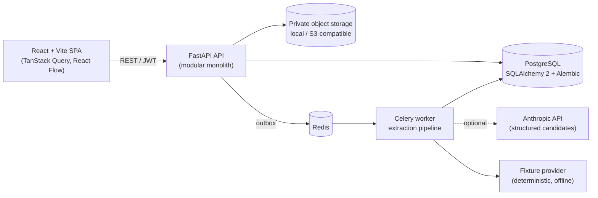

<div align="center">

# FactoryBridge

**AI-assisted manufacturing change intelligence: going from changing hardware designs to explainable, approval-gated manufacturing readiness.**

[](https://github.com/vishnup22/factorybridge/actions/workflows/ci.yml)


<br/>

<a href="https://skillicons.dev">
  
</a>

</div>

---

> [!IMPORTANT]
> FactoryBridge is an **independent demonstration project**. It is not affiliated with any company, and it has no access to any company's data or systems. All data is synthetic and all manufacturing actions are simulated. It is **not** a safety-certification tool.

## What it does

FactoryBridge takes product requirements for a small warehouse service robot (*Warehouse Scout V1*) and tracks the downstream impact of engineering changes before anything is released to (simulated) production.

1. **Ingest:** upload a text-based requirements PDF and/or a CSV BOM. Extraction produces typed *candidates*, each with document, page and snippet evidence.
2. **Review:** an engineer accepts or corrects the candidates, which creates an immutable BOM revision **R1**.
3. **Approve:** an approver signs off on the readiness baseline R1, and the project becomes `READY`.
4. **Change:** an engineering change (for example `ACT-100` 24V/M4-40 → `ACT-200` 48V/M6-50) creates revision **R2**.
5. **Blast radius:** a deterministic graph traversal flags every affected artifact (supplier selection, electrical compatibility, assembly instructions, QC plan and prior approval) with reason codes, severity and required owners.
6. **Gate:** the project becomes `BLOCKED`. The R1 approval is kept for audit but is **not valid for R2**. Only after authorized fixes and a fresh approval of the exact new baseline can R2 become `READY`.

### Core principles

- **AI extracts, proposes and explains. Deterministic code validates and gates.** An LLM never approves anything or writes production state.
- Each approval is bound to an **exact baseline hash and version**, so a stale approval always fails.
- BOM revisions and audit events are **append-only and immutable**.
- RBAC and org/project isolation are enforced **server-side on every request**, with separation of duties (the author of a change cannot approve it).
- A critical compatibility result of `UNKNOWN` means **blocked**, never auto-approved.
- Retries and replays are **idempotent**, and the transactional outbox doesn't assume exactly-once delivery.

## Architecture



| Layer | Contents |
|---|---|
| `backend/app/domain` | Pure domain logic: BOM revisions and diffs, baseline hashing, dependency graph, impact traversal, compatibility rules, readiness |
| `backend/app/services` | Approvals, changes, exceptions, audit, idempotency, outbox, storage, and the extraction pipeline (parsers, evidence verification, review) |
| `backend/app/api/v1` | Auth, projects, documents, health/metrics endpoints |
| `backend/app/workers` | Celery tasks for async extraction |
| `frontend/src/pages` | BOM diff, change editor, impact graph, exception inbox, extraction review, approvals, audit timeline |
| `demo/` | Synthetic fixtures (BOMs, supplier catalog, compatibility rules, PDFs including malformed, scanned and prompt-injection cases) and seed script |

## Tech stack

| | |
|---|---|
| **Backend** | Python 3.12, FastAPI, Pydantic v2, SQLAlchemy 2, Alembic, Celery, PyJWT, Argon2, pypdf, boto3 |
| **Frontend** | React 19, TypeScript, Vite, Tailwind CSS v4, TanStack Query, React Router, React Flow (`@xyflow/react`) |
| **Data** | PostgreSQL 16, Redis 7, S3-compatible private storage (e.g. Cloudflare R2, MinIO) |
| **AI** | Optional Anthropic structured extraction; deterministic **fixture mode** by default (no network, no key) |
| **Quality** | pytest, Hypothesis, Ruff, mypy, pip-audit, Vitest, Testing Library, Playwright, ESLint |
| **Infra** | Docker Compose, GitHub Actions, Render Blueprint (API + worker + DB + Redis), Vercel (frontend) |

## Quickstart

**Prerequisites:** Docker, [uv](https://docs.astral.sh/uv/), Node.js.

```bash
cp .env.example .env          # safe local defaults; never commit .env
make up                       # API on :8000, web on :5173 (DB/Redis bound to 127.0.0.1)
make seed                     # synthetic demo accounts → backend/var/demo_credentials.txt
make demo                     # run the flagship R1 → R2 → BLOCKED → READY scenario via the API
```

Then open http://localhost:5173 and sign in with one of the generated demo accounts (customer, engineer, approver or admin).

With no `ANTHROPIC_API_KEY` set, the app runs in **fixture mode**: a deterministic walkthrough that's clearly labeled as such. To use live extraction, set `AI_PROVIDER=anthropic`, `ANTHROPIC_API_KEY` and `AI_MODEL` in `.env`.

## Testing

```bash
make test        # backend unit + integration (needs compose Postgres/Redis) and frontend Vitest
make lint        # ruff, ruff format, mypy, eslint, tsc
make e2e         # Playwright UI flow against the running stack
```

The integration suite covers the acceptance scenarios in the spec: stale-approval rejection, separation of duties, cross-org isolation, idempotent replay, concurrency, S3 storage, and prompt-injection fixtures. CI runs lint, type checks, migration drift checks (`alembic check`) and tests on every push and pull request.

Extraction evaluation (fixture mode) can be regenerated with `scripts/evaluate_extraction.py`. Results are written to `docs/evaluation_results.json`.

## Deployment

- **API, worker, Postgres and Redis:** [`render.yaml`](render.yaml) Render Blueprint. Secrets are entered in the dashboard and none are committed.
- **Frontend:** [`frontend/vercel.json`](frontend/vercel.json), a Vite static build with a strict CSP and security headers.

## Repository guide

| File | Purpose |
|---|---|
| [`FACTORYBRIDGE_MASTER_SPEC.md`](FACTORYBRIDGE_MASTER_SPEC.md) | Product and engineering spec (source of truth, acceptance tests AT-01 to AT-14) |
| [`AGENTS.md`](AGENTS.md) | Engineering rules for AI coding agents working on this repo |
| `CURSOR_START_HERE.md`, `CODEX_REVIEW_PROMPT.md`, `CLAUDE_CODE_REVIEW_PROMPT.md` | Agent kickoff and review prompts |
